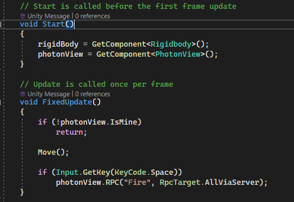

# Networked Multiplayer Game

Academic project by Mohammed Siddiqui · Unity / C# / Photon PUN / PlayFab

A multiplayer game prototype exploring player control, shared game state, room management, chat and score persistence. This curated source collection accompanies the original Games Networking and Security coursework.

## Explore the implementation

| Source | What to look for |
| --- | --- |
| [Multiplayer.cs](Multiplayer.cs) | Local input ownership, firing RPCs, collision damage and health serialization |
| [MultiplayerLobby.cs](MultiplayerLobby.cs) | Four-player rooms, room lists, joining/leaving and scene transitions |
| [Chat.cs](Chat.cs) | Room chat subscriptions and message callbacks |
| [GlobalLeaderboard.cs](GlobalLeaderboard.cs) | PlayFab score submission and leaderboard retrieval |
| [MultiplayerLevelManager.cs](MultiplayerLevelManager.cs) | Game-over state and personal-best persistence |

## Engineering decisions and limits

`PhotonView.IsMine` restricts input handling to the local player. Firing is broadcast with `RpcTarget.AllViaServer`, while `IPunObservable` serializes health. Room callbacks update the lobby interface and the master client starts the shared scene.

Relaying an RPC through a server does **not** make gameplay server-authoritative. This prototype retains client-side game logic; authoritative damage validation, RPC rate limiting and testing under latency would be valuable next steps. These are proposed improvements, not completed features.

## Review status

The code and report were reviewed for this portfolio; a new multiplayer runtime test has not been performed. These are selected original scripts, not a standalone Unity build. They require the original scenes, prefabs, supporting scripts and configured Photon/PlayFab services. SDKs, third-party assets and service settings are not redistributed here.
