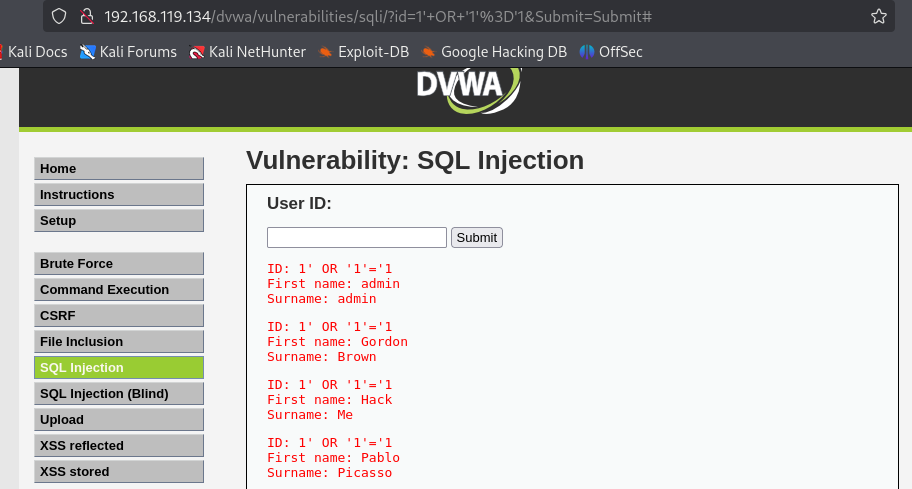

# Virtual Machine Security Lab

Academic investigation by Mohammed Siddiqui · Kali Linux / Nmap / tcpdump / DVWA

A documented cybersecurity coursework investigation of intentionally vulnerable training systems. The work connects service discovery, network observation and web vulnerability testing with defensive recommendations.

## Investigation and evidence

| Area | Work documented | Defensive relevance |
| --- | --- | --- |
| Discovery | DNS queries, Nmap service enumeration and SMB investigation | Identify exposed services and unnecessary access |
| Network analysis | Packet capture and ARP-related exercises in the virtual lab | Understand traffic visibility and local-network trust |
| Web applications | SQL injection exercises in DVWA, alongside XSS and request-manipulation tasks | Parameterized queries, output encoding and robust request validation |
| Reporting | Screenshots, explanations of impact and mitigation discussion | Communicate findings and remediation priorities |

The screenshot shows multiple seeded DVWA records returned during a SQL injection exercise. These are demonstration records in an intentionally vulnerable application, not real customer data.

## Main lessons

- Separate discovery results from confirmed vulnerabilities: an exposed service or old version alone does not prove successful exploitation.
- Use parameterized queries and least-privilege database access to address SQL injection.
- Reduce exposed services, restrict anonymous access and maintain supported software.
- Apply context-appropriate output encoding and secure session handling to web applications.

## Scope and review status

This is a curated summary of the original Cyber Security coursework report, supported by an original lab screenshot. It represents an academic VM exercise, not a commercial penetration test or a newly validated security assessment. The full report contains broader exercises and is not reproduced here. Recommendations are discussed, not claimed as deployed fixes.
